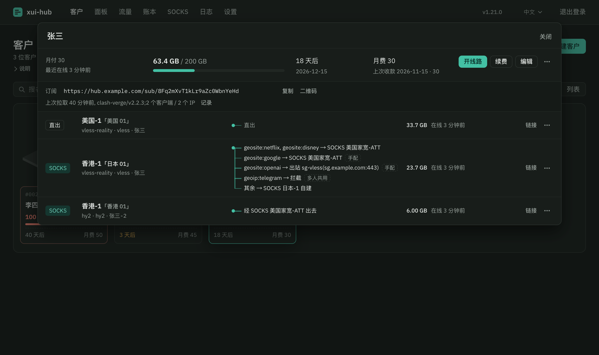
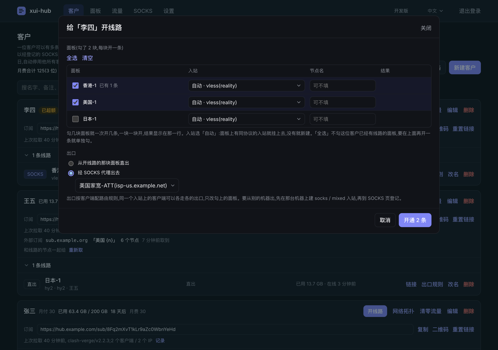
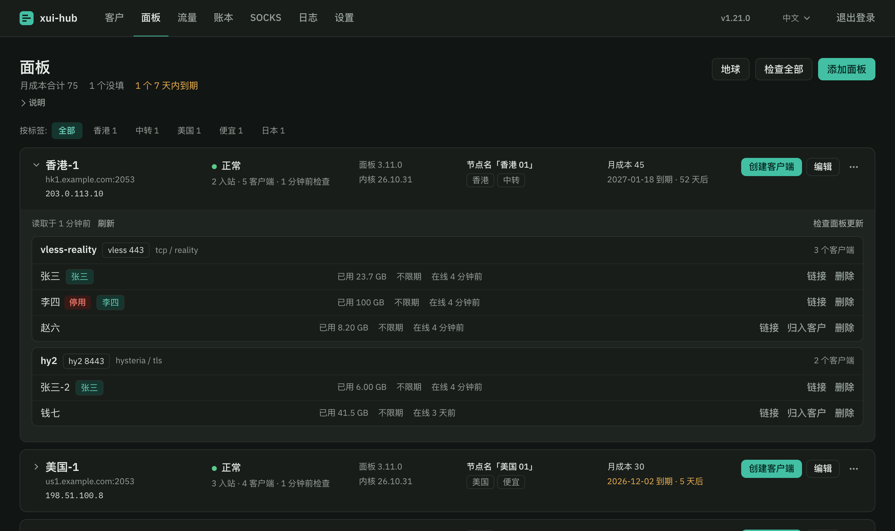
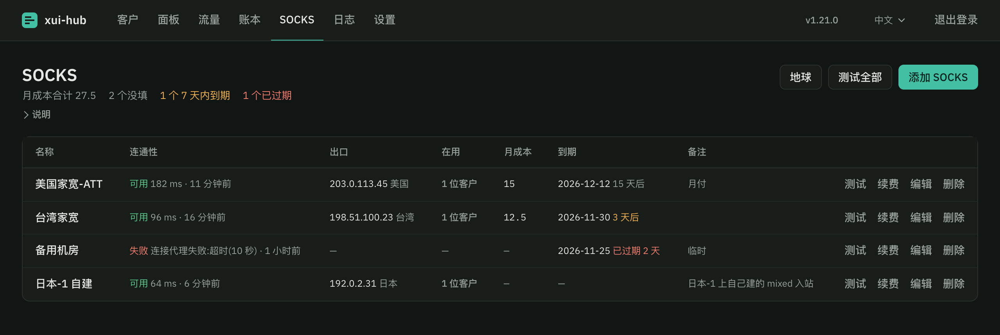

# xui-hub

把多台 3x-ui 面板接到一个后台,按客户统一管理线路、额度、到期和订阅。

## 安装

需要一台 1 核 1 GB 的服务器,放行 8788 端口,能访问各面板的地址。

### 一键脚本

root 执行(amd64 / arm64,systemd 发行版):

```bash
bash <(curl -fsSL https://raw.githubusercontent.com/fishermanxzx/xui-hub/main/install.sh)
```

按提示设后台密码和端口(回车 = 随机密码、8788),装完打印后台地址和密码。非交互安装用环境变量 `XUIHUB_PASSWORD`、`XUIHUB_PORT`。

管理命令(不带参数是菜单):

| 命令 | 作用 |
|---|---|
| `xui-hub status` / `log` | 状态 / 日志 |
| `xui-hub start` / `stop` / `restart` | 启停 |
| `xui-hub update` | 更新 |
| `xui-hub password` / `port` | 改密码 / 端口 |
| `xui-hub ssl` | 申请 HTTPS 证书(域名或 IP,自动续期) |
| `xui-hub backup` / `restore <文件>` | 备份 / 恢复 |
| `xui-hub uninstall` | 卸载 |

程序在 `/usr/local/xui-hub`,数据和配置在 `/etc/xui-hub`。

### Docker

```bash
mkdir -p /opt/xui-hub/data && cd /opt/xui-hub
chown 1000:1000 data
curl -fsSLO https://raw.githubusercontent.com/fishermanxzx/xui-hub/main/docker-compose.yml
echo "ADMIN_PASSWORD=换成你的密码" > .env
docker compose up -d
```

密码含 `$`、`#`、空格时用单引号:`ADMIN_PASSWORD='p@ss $word'`。

更新:

```bash
docker compose pull && docker compose up -d
```

HTTPS(在 `docker-compose.yml` 所在目录执行,证书放在 `./cert`):

```bash
bash <(curl -fsSL https://raw.githubusercontent.com/fishermanxzx/xui-hub/main/scripts/docker-ssl.sh)
```

### 开始使用

1. 打开 `http://<服务器 IP>:8788`,输入后台密码。
2. 「面板」页添加 3x-ui 面板:填面板地址(含 webBasePath)和 API token(3x-ui「面板设置 → API」里生成)。
3. 「客户」页新建客户,点「开线路」,把订阅链接发给客户。

数据在 `hub.db`(一键脚本在 `/etc/xui-hub`,Docker 在 `data`),「设置」页可下载和恢复。

### 环境变量

写在 `.env`(一键脚本是 `/etc/xui-hub/.env`),改完重启。

| 变量 | 默认 | 说明 |
|---|---|---|
| `ADMIN_PASSWORD` | 无 | 后台密码,必填 |
| `LISTEN_ADDR` / `HOST_PORT` | `0.0.0.0` / `8788` | 监听地址和端口 |
| `CHECK_INTERVAL_SEC` | `60` | 同步面板、检查额度和到期的间隔(秒) |
| `TLS_CERT_FILE` / `TLS_KEY_FILE` | 空 | 证书和私钥,都填即启用 HTTPS |
| `PANEL_HOST` | 空 | 一键脚本显示后台地址用的域名或 IP |
| `SUB_BASE_URL` | 空 | 订阅链接的地址前缀,空 = 打开后台时的地址 |
| `MIHOMO_TEMPLATE` | 空 | Clash / Stash 订阅套用统一头部(DNS、嗅探等):空或 `all` = 全部客户,`off` = 关闭,或逗号分隔的客户名 |
| `SUB_LOG_DAYS` | `7` | 订阅拉取记录保留天数 |
| `INTERNAL_PORT` | `8789` | 订阅转换的内部端口,只绑本机 |

## 功能

**客户与线路**

- 客户页默认是「机位」:所有客户一间大厅,一人一台电脑(3D 小场景),每条线路一根网线(颜色按面板,停用的灰色虚线,正在用的线上有数据在流);在线的坐着打字、屏幕亮着,时不时抽根烟、喝口饮料、吃零食、伸个懒腰,不在线的趴在桌上睡觉,名牌上写最近一次在线是多久前(多条线路取最近的);下面只写名字、流量、到期、月费,点开看订阅、线路和操作。也可以切回列表。
- 一位客户多条线路,每条线路是某块面板上的一个客户端,协议 vless reality 或 hy2。
- 开线路可一次勾多块面板;批量开线路一次给多位客户各开一条(选客户时可用和客户页一样的筛选);批量删线路按面板一次删掉。
- 出口:面板直出,或经登记的 SOCKS 出去;可原地换出口,UUID 不变、客户不用更新订阅。一位客户可以一键「换出口 IP」:主出口和出口规则里用到旧出口的一起换。
- 出口规则:按域名(含 geosite)、IP(含 geoip)、端口、网络指定走哪个 SOCKS、直出或拦截;可浏览面板上的 geo 库,保存前核对分类;面板上手配、只点名这位客户的规则可以删掉或接管;一位客户的几条线路可以批量改成同一组规则。
- 显示面板上实际的出口,每位客户一张网络拓扑图。
- 额度和到期按客户算(各线路流量之和),超额或到期自动停用,续费、加额度、清零后自动恢复。
- 面板可设流量倍率(贵的线路按 1.2 之类计费),每月自动重置、手动调整已用、设备数上限。
- 续费时记收款;每条线路可看分享链接和二维码。
- 搜索、按面板 / 面板标签 / 状态 / 线路条数 / 落地 IP 个数 / 落地 IP / 规则分流筛选,多种排序。

**订阅**

- 每位客户一条订阅链接,按客户端自动出格式:Clash / Mihomo / Stash / Shadowrocket、sing-box / Hiddify、Surge、Quantumult X、Loon、v2rayN。
- 节点名可按线路或按面板设;可配自定义订阅地址(沿用旧链接)。
- 外部订阅:把别处的订阅节点并进客户的订阅。
- Clash 分组和规则可选内置 ACL4SSR 模板或自定义模板。
- 浏览器打开订阅链接是客户自助页:剩余流量、到期、每天用量、一键导入、节点测延迟、设备管理。

**面板与 SOCKS**

- 接入 3x-ui 面板,每分钟同步;看版本、入站、客户端,创建 / 删除客户端,归入已有客户端;点客户端后面的客户名跳到这位客户。
- 面板页、SOCKS 页默认是「机房」:像网吧一样一块面板(或一个 SOCKS)一间房,房里坐着在上面有线路的客户,接在这间房的网线亮着;面板连不上、SOCKS 测试不通的房间关灯;点哪位到客户页看他。可以切回卡片 / 表格。
- 面板节点名、标签;面板页可按名称 / IP / 地址搜索,按面板 IP、标签筛选;切换 Xray 内核、升级面板、重启。
- 卸载面板(过期了、不想要了的):从客户名下删掉上面的线路;面板连得上先删掉这些线路在面板上的客户端,连不上直接删记录。流量历史照旧按原来的名字和倍率显示,面板 id 不复用。
- 面板页、SOCKS 页的 3D 地球(卫星图,贴图来自 NASA Blue Marble):标出各面板 / 各 SOCKS 出口的位置(点旁边写按 IP 查到的城市)和分布在哪些国家、地区(可拖动、自动旋转),点一下跳到那一个。位置按 IP 查公开的 IP 库(ipwho.is / ipinfo.io,只在打开地球时查;SOCKS 按测出来的出口 IP),不准可以手动填坐标。
- 登记 SOCKS5 代理,测连通性、出口 IP、地区和延迟。
- 面板和 SOCKS 可记月成本和到期日;续了费点「续费」顺延到期日,顺手在账本记一笔支出。

**统计与记账**

- 「流量」页:按客户、按面板看每天用量和走势,可排除面板、只看某些客户。
- 「账本」页:收入、支出、净收入,月费合计、月成本、每月结余、待续费、收支明细;续费以外的收入 / 支出(如买服务器、域名)点「记一笔」自己记,可以关联面板、SOCKS 或客户;记过的每一笔都能改、能删。
- 「日志」页:每次改动记下时间、操作人、IP、改了什么、成没成,保留一年。

**通知与备份**

- 通知(Telegram / 飞书 / Webhook):面板掉线与恢复、客户超额 / 到期 / 快到期、流量用到某个比例、订阅疑似被分享、面板 / SOCKS 快到期。
- 每日自动备份到 Telegram 或 S3 兼容存储(R2、MinIO 等),后台可直接用远端备份恢复。

**其它**

- 开放 API([docs/api.md](docs/api.md))和 MCP 服务([docs/mcp.md](docs/mcp.md)),可接发卡站、机器人或 AI 客户端。
- 中文 / English;深色 / 浅色;手机可用。
- 后台提示新版本,一键脚本安装的可在后台直接更新。

说明:新建 hy2 入站需要面板自己配置了证书。xui-hub 只在开删线路、停用恢复、清零流量、改出口和出口规则、切换内核、升级和重启面板时改动面板,其余只读。

## 界面

图中均为演示数据。











## License

MIT
