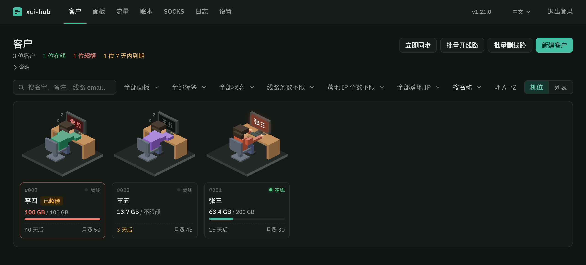
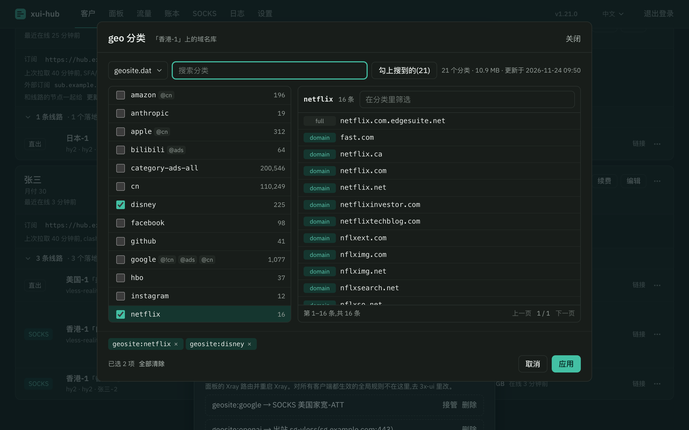
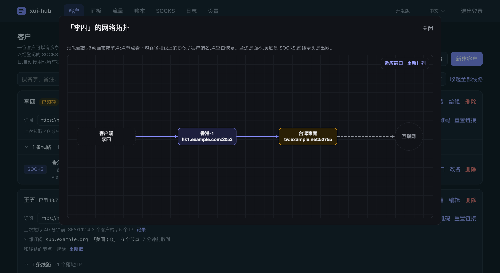

# xui-hub

把多台 3x-ui 面板接到一个后台,按「客户」统一管理线路、额度、到期和订阅。

## 界面预览

图中均为演示数据。

**客户**:额度、到期、订阅链接和全部线路。



**开线路**:勾一块或几块面板,每块各选入站,一次开好;从各自的面板直出,或经登记的 SOCKS 出去。


**出口规则**:按条件给线路指定出口;点「浏览 geo 分类」直接看线路所在面板上的 geosite / geoip 库,搜分类、看分类里的域名和网段,勾选后填进规则。



**网络拓扑**:每位客户一张可缩放的线路图。



**面板**:版本、入站和客户端。


**SOCKS**:代理的连通性和出口 IP。


## 功能

**客户**

- 一位客户可以有多条线路,每条线路是某块面板上的一个客户端,协议可选 vless reality 或 hy2。
- 开线路:可以一次勾几块面板,每块面板开一条;入站每块单独选(自动选择或指定,没有同协议入站时自动新建),节点名可不填;出口所有勾上的面板一样。逐块开,每行显示结果,没开成的留着勾,改一改再开。每条线路只改它所在的那块面板,不碰别的面板。
- 出口:默认从这块面板直出;也可以选 SOCKS 页登记的代理,在这块面板上按客户端加一条路由规则。要从另一台机器出(中转),在那台机器上自己建 socks / mixed 入站,登记到 SOCKS 页即可。同一入站上的客户端可以走不同出口。
- 额度和到期按客户计算,流量是各线路之和,每分钟同步一次。超额或到期自动停用他的全部客户端,调整额度、续期或清零流量后自动恢复。
- 删线路时它本期用掉的流量留在客户的已用里;面板上的计数被清零或客户端重建时,旧计数也会留下。可以手动调整本期已用(迁移旧用量、纠错),只记在 xui-hub 里,不改面板。
- 每位客户可设流量倍率(默认 1):订阅里显示的已用、额度和超额停用按「实际流量 × 倍率」算,线路贵的客户调高。线路流量和流量统计仍是实际值。
- 可勾选每月自动重置流量(每位客户独立):重置日跟着到期日走,续费后跟着变;没设到期日的填每月几号。编辑时可一键续期 30 / 90 / 180 / 365 天。
- 可记每位客户的月费:客户页顶上合计没到期客户的月费,减去面板和 SOCKS 的月成本得出结余;快到期的提醒里带上月费。只用来记账。
- 可设设备数上限:每个导入过订阅的客户端算一台(按客户端的 UA 区分),满了以后新设备拉不到订阅;客户在自助页里可以自己移除旧设备。只管订阅链接,不改面板。
- 批量开线路:选一块面板和入站,勾选多位客户,一次给每人各开一条(加了新面板时常用)。每位客户一行,列出他已有的节点;出口和节点名单独设:出口默认照抄他最新那条线路(出口和出口规则一起),没有线路的默认直出,也可以改成直出或某个 SOCKS;节点名可不填。逐个开,每行显示结果,可中途停止。
- 批量删线路:选一块面板,勾选客户,把他们在这块面板上的线路一次删掉(面板上的客户端和出口规则一起删,本期流量留在客户已用里);同一块面板只连一次、Xray 最多重启一次。面板连不上时可以只删记录。
- 每条线路可看分享链接和二维码,每位客户可看一张可缩放的网络拓扑图。
- 客户页可搜索(名字、备注、线路 email、节点名),按面板(可多选)和状态(正常 / 7 天内到期 / 超额 / 到期)过滤,按名称、到期日、已用流量、月费、新建时间或最近拉订阅排序;线路默认收起成一行(条数、节点名、停用几条),点开看详情。
- 可以给线路配出口规则(「条件 → 出口」,比如流媒体走 A、国内直连、去广告),xui-hub 写到面板的 Xray 路由并重启 Xray;没命中的流量走线路原来的出口。条件支持域名(含 geosite)、IP(含 geoip)、端口、网络,出口可选登记的 SOCKS、直出、拦截。只改 xui-hub 写的规则,面板上手配的不动。
- 出口规则的域名、IP 框旁边能浏览线路所在面板上的 geo 库(geosite.dat、geoip.dat 和面板上另装的库):搜分类、看分类里的域名 / 网段,勾选后填进规则。填的分类会按那块面板的库核对,分类名写错、库不存在、geoip 填进域名这类会让 Xray 起不来的,保存前就拦下。浏览和核对要求面板是 3x-ui 3.7.0 及以上,更老的面板照旧手填。
- 线路显示面板上实际的出口:每分钟同步时读面板的 Xray 路由规则。同一个客户端在面板上按规则配了多个出口(比如流媒体走 A、其余走 B),线路和拓扑图里会逐条列出条件和去向;登记过的 SOCKS 按地址认出来。只读,不改面板。

**订阅**

- 每位客户一条订阅链接,包含他的全部线路,按客户端自动给出格式:Clash / Mihomo / Stash / Shadowrocket、sing-box / Hiddify、Surge、Quantumult X、Loon、v2rayN(base64),也可用 `?target=` 指定。链接可重置,可查看拉取记录(时间、客户端、IP)。
- 每条线路可以自定义节点名(客户拉订阅时看到的名字),不填就用面板生成的。
- 可给客户另配自定义订阅链接(任意路径,可带参数),访问它和访问生成的链接一样。可以沿用别的系统发出去的旧链接(把旧域名指过来即可),也可以给客户一个好记的地址。
- 外部订阅:可给客户配上别处的订阅地址(比如出口代理商给的),那边的节点会出现在客户自己的订阅里,客户不用换链接。
  - 那边的内容可以是节点链接(base64)、Clash 配置或 sing-box 配置,每种客户端格式都会给出。
  - 只取那边的节点,分组和规则用这里的订阅模板;节点名可以改(固定名字,或用 `{name}` / `{n}` 拼)。
  - 可以和客户自己线路的节点一起给,也可以只给外部的;客户端里显示的流量和到期可以改用那边给的。
  - 取不到时用上次取到的。客户到期或超额时,和自己的线路一样不出节点。
- Clash 系客户端的分组和规则可以按客户选模板:内置 ACL4SSR 的精简(默认)/ 标准 / 完整及其无自动测速、多模式、按地区等变体,也可以填自己的模板地址(保存时会试拉一次,取不到或不是模板不让存)。
- 客户用浏览器打开订阅链接是一个自助页:剩余流量、到期日、下次重置日、各客户端的一键导入按钮、订阅链接和二维码、线路(订阅里的节点名,由客户的浏览器直接连节点测延迟),以及已导入订阅的设备。不显示流量明细,也不显示后台用的是什么程序。

**面板**

- 填面板地址和 API token 接入,每分钟同步一次状态,掉线 / 恢复有通知。
- 卡片显示面板版本、Xray 内核版本、入站和客户端,可直接创建或删除客户端。
- 面板上已有的客户端可勾选「归入客户」,成为该客户的线路,面板上不改任何东西。
- 可切换 Xray 内核版本、升级面板、一键重启面板和内核。
- 可记每块面板的月成本和到期日:页面上合计月成本,7 天内到期标黄、过期标红。

**SOCKS**

- 登记 SOCKS5 代理(买的代理,或自己在别的机器上建的 socks / mixed 入站),测试连通性、出口 IP、地区和延迟,开线路时可选作出口。
- 同样可记月成本和到期日,列表里合计、快到期标黄。

**流量统计**

- 按天记每个客户端用的流量,「流量」页按客户、按面板两种视图看最近 1 / 7 / 30 / 90 天的用量和每天的走势,点进去看名下各客户端。保留一年。
- 统计时可以排除某些面板(可多选):总量、走势、按客户(客户在这些面板上的线路)、按面板都不算它们的流量。只是统计时跳过,记录照常保留,取消排除就回来。

**通知**

- Telegram Bot、飞书(Lark)群机器人或通用 Webhook:面板掉线 / 恢复、客户超额或到期被停用 / 恢复、客户快到期、流量用到额度的某个百分比、按月清零完成、订阅疑似被分享(24 小时内被多个 IP 拉取)。「设置」页配置,可发测试消息。

**备份**

- 「设置」页下载数据库备份、上传备份恢复(恢复后服务自动重启)。
- 每日自动备份:发到 Telegram,或压缩后传到 S3 兼容的对象存储(Cloudflare R2、MinIO 等)异地保存。远端按保留天数自动清理(总留最新 3 份),后台能看远端列表、手动「现在备份」、直接用远端的某一份恢复。
- 一键脚本另有 `xui-hub backup` / `xui-hub restore`。

**开放 API 与 MCP**

- 「设置」页生成 API 令牌,发卡站或机器人带着令牌就能建客户、续期、开线路、取订阅链接。接口说明见 [docs/api.md](docs/api.md)。
- 自带 MCP 服务(`/mcp`):Claude、Cursor 等 AI 客户端可以直接查客户、建客户、续期、开线路。支持 OAuth 授权和 API 令牌两种接入方式,见 [docs/mcp.md](docs/mcp.md)。

**其它**

- 中文 / English 两种界面语言:默认跟浏览器,顶栏可切换。
- 自动发现新版本:顶栏显示当前版本,有新版本时提示;一键脚本装的可以在后台里直接点更新(新版本起不来会自动退回),Docker 装的给出要执行的命令。
- 后台可开 HTTPS:一键脚本 `xui-hub ssl`、Docker 用 `scripts/docker-ssl.sh`,给域名或 IP 申请 Let's Encrypt 证书并自动续期。
- 深色 / 浅色主题跟随系统;手机上也能用。

说明:新建 hy2 入站要用面板自己配置的证书,面板没配证书就建不了。xui-hub 只在开线路、删线路、自动停用与恢复、清零流量、切换内核、升级面板、重启时改动面板,其余操作只读。

## 部署

服务器 1 核 1 GB 即可,需要放行 8788 端口,并能访问各面板的 API 地址。两种方式任选其一。

### 方式一:一键脚本

root 执行,支持 amd64 / arm64 的 systemd 发行版:

```bash
bash <(curl -fsSL https://raw.githubusercontent.com/fishermanxzx/xui-hub/main/install.sh)
```

安装时会询问后台密码和端口,直接回车是随机密码和 8788,装完会打印后台地址和密码。非交互安装用环境变量 `XUIHUB_PASSWORD` 和 `XUIHUB_PORT`。

之后用 `xui-hub` 命令管理,不带参数是菜单:

| 命令 | 作用 |
|---|---|
| `xui-hub status` / `log` | 运行状态 / 实时日志 |
| `xui-hub start` / `stop` / `restart` | 启停 |
| `xui-hub enable` / `disable` | 开机自启 |
| `xui-hub update` | 更新到最新版 |
| `xui-hub password` / `port` / `settings` | 改密码 / 改端口 / 查看设置 |
| `xui-hub ssl` | 申请和管理 HTTPS 证书 |
| `xui-hub backup` / `restore <文件>` | 备份到 `/etc/xui-hub/backup`(最多留 30 份)/ 从备份恢复 |
| `xui-hub uninstall` | 卸载 |

程序在 `/usr/local/xui-hub`,数据和配置在 `/etc/xui-hub`。

### 方式二:Docker

```bash
mkdir -p /opt/xui-hub/data && cd /opt/xui-hub
chown 1000:1000 data
curl -fsSLO https://raw.githubusercontent.com/fishermanxzx/xui-hub/main/docker-compose.yml
echo "ADMIN_PASSWORD=换成你的密码" > .env
docker compose up -d
```

密码里有 `$`、`#`、空格这类字符时用单引号包起来:`ADMIN_PASSWORD='p@ss $word'`。

更新:

```bash
docker compose pull && docker compose up -d
```

### 使用

1. 浏览器打开 `http://<服务器 IP>:8788`,用后台密码登录。
2. 「面板」页添加 3x-ui 面板,填地址和 API token。
3. 「客户」页新建客户,再给他开线路。

数据都在数据库文件 `hub.db` 里(一键脚本在 `/etc/xui-hub`,Docker 在 `data` 目录),「设置」页可以下载和恢复。

### HTTPS

默认是 HTTP。

- 一键脚本:运行 `xui-hub ssl`,可给域名或 IP 申请 Let's Encrypt 证书并自动续期。
- Docker:在放 `docker-compose.yml` 的目录里运行下面的命令,同样可给域名或 IP 申请证书并自动续期(证书放在 `./cert`)。也可以自己把证书放进 `./cert`,在 `.env` 填 `TLS_CERT_FILE=/cert/fullchain.pem` 和 `TLS_KEY_FILE=/cert/privkey.pem`。

  ```bash
  bash <(curl -fsSL https://raw.githubusercontent.com/fishermanxzx/xui-hub/main/scripts/docker-ssl.sh)
  ```
- 也可以在前面放 Caddy / Nginx 反代。

### 环境变量

写在 `.env` 里,一键脚本的在 `/etc/xui-hub/.env`,改完重启生效。

| 变量 | 默认 | 说明 |
|---|---|---|
| `ADMIN_PASSWORD` | 无 | 后台密码,必填 |
| `LISTEN_ADDR` / `HOST_PORT` | `0.0.0.0` / `8788` | 监听地址和端口 |
| `CHECK_INTERVAL_SEC` | `60` | 同步面板并执行额度 / 到期的间隔(秒) |
| `TLS_CERT_FILE` / `TLS_KEY_FILE` | 空 | 证书和私钥路径,两项都填即启用 HTTPS |
| `PANEL_HOST` | 空 | 一键脚本显示后台地址用的域名或 IP,`xui-hub ssl` 设证书时自动写入;空则从证书里取 |
| `SUB_BASE_URL` | 空 | 订阅链接的地址前缀,空则用打开后台时的地址 |
| `MIHOMO_TEMPLATE` | 空(= 全部) | Clash / Stash 订阅套用统一的头部(DNS、域名嗅探、地理数据下载地址、并发连接等,分组和规则不变):空或 `all` = 全部客户,`off` = 关闭,也可以填逗号分隔的客户名 |
| `SUB_LOG_DAYS` | `7` | 订阅拉取记录保留天数 |
| `INTERNAL_PORT` | `8789` | 订阅转换用的内部端口,只绑本机,端口冲突时才需要改 |

## License

MIT
