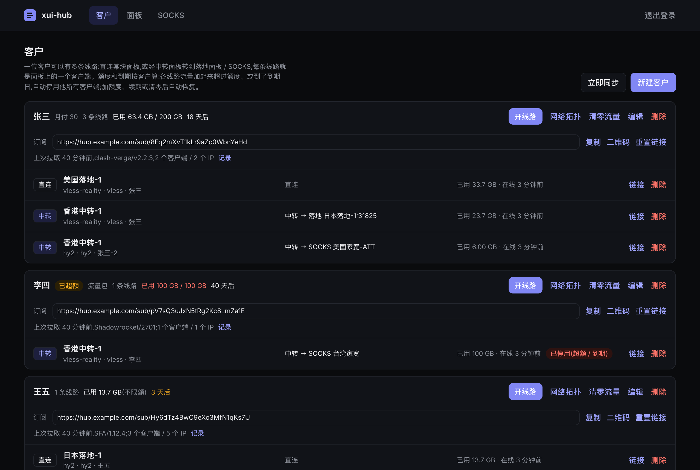
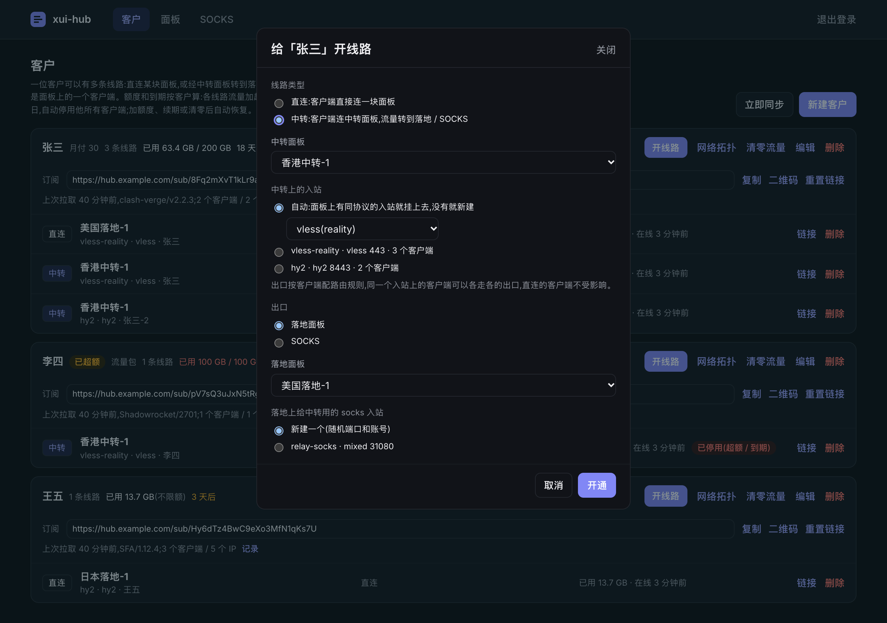
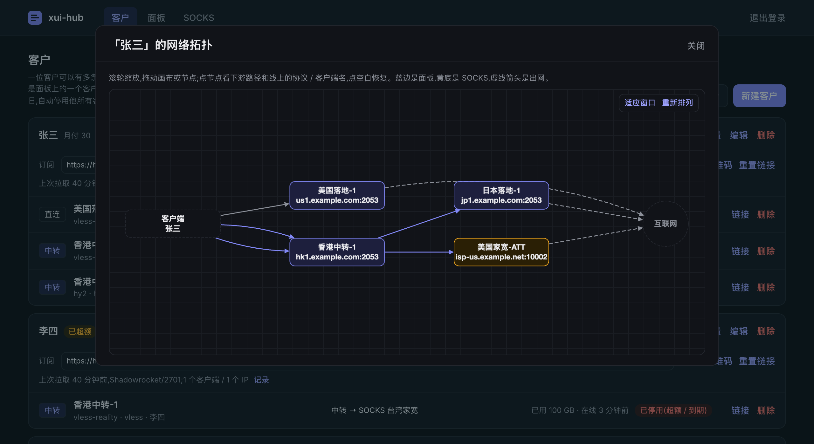
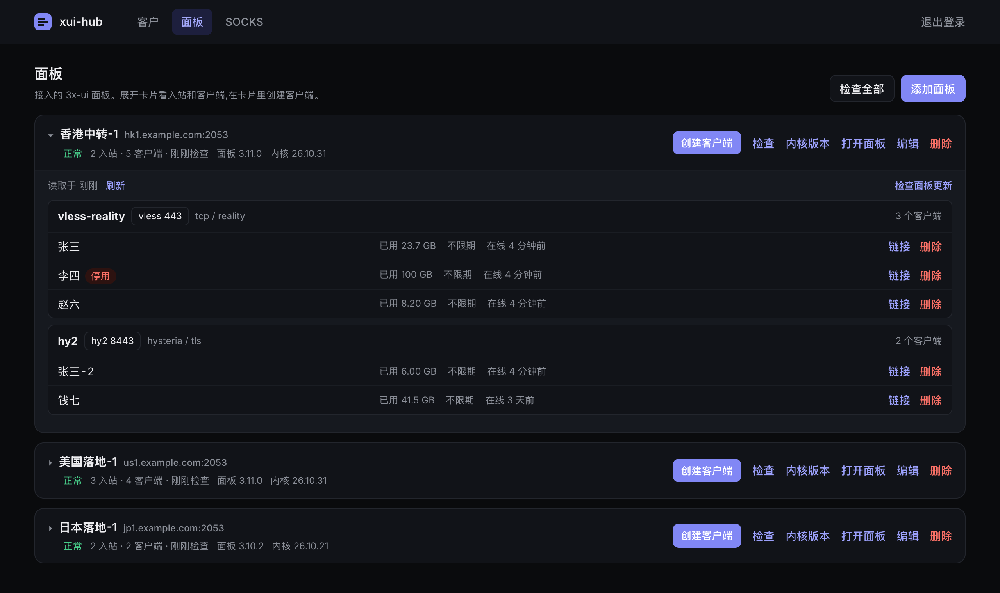
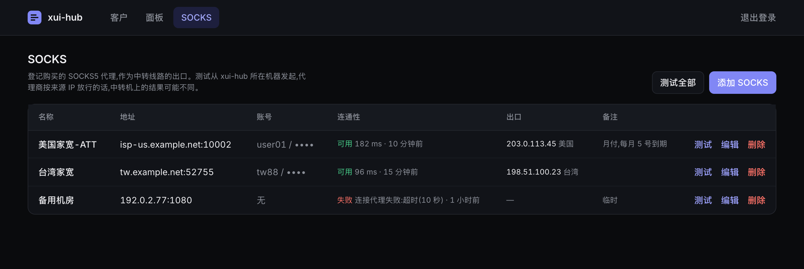

# xui-hub

把多台 3x-ui 面板接到一个后台,按「客户」统一管理线路、额度、到期和订阅。

## 界面预览

图中均为演示数据。

**客户**:额度、到期、订阅链接和全部线路。



**开线路**:直连,或经中转面板转到落地面板 / SOCKS。



**网络拓扑**:每位客户一张可缩放的线路图。



**面板**:版本、入站和客户端。



**SOCKS**:代理的连通性和出口 IP。



## 功能

**客户**

- 一位客户可以有多条线路,每条线路是某块面板上的一个客户端,协议可选 vless reality 或 hy2。
- 直连线路:选面板,入站自动选择或指定;没有同协议入站时自动新建。
- 中转线路:选中转面板和出口。出口可以是落地面板上的 socks 入站(没有就自动新建),也可以是 SOCKS 页登记的代理。路由按客户端区分,同一入站上的客户端可以走不同出口。
- 额度和到期按客户计算,流量是各线路之和,每分钟同步一次。超额或到期自动停用他的全部客户端,调整额度、续期或清零流量后自动恢复。
- 每位客户一条订阅链接,包含他的全部线路,按客户端自动给出格式:Clash / Mihomo / Stash / Shadowrocket、sing-box / Hiddify、Surge、Quantumult X、Loon、v2rayN(base64),也可用 `?target=` 指定。链接可重置,可查看拉取记录。
- 每条线路可看分享链接和二维码,每位客户可看网络拓扑图。

**面板**

- 填面板地址和 API token 接入,每分钟同步一次状态。
- 卡片显示面板版本、Xray 内核版本、入站和客户端,可直接创建或删除客户端。
- 可切换 Xray 内核版本、升级面板。

**SOCKS**

- 登记 SOCKS5 代理,测试连通性、出口 IP、地区和延迟,供中转线路当出口。

说明:新建 hy2 入站要用面板自己配置的证书,面板没配证书就建不了。xui-hub 只在开线路、删线路、自动停用与恢复、清零流量、切换内核、升级面板时改动面板,其余操作只读。

## 部署

服务器 1 核 1 GB 即可,需要放行 8788 端口,并能访问各面板的 API 地址。两种方式任选其一。

### 方式一:一键脚本

root 执行,支持 amd64 / arm64 的 systemd 发行版:

```bash
bash <(curl -fsSL https://raw.githubusercontent.com/fishermanxzx/xui-hub/main/install.sh)
```

安装时会询问后台密码和端口,直接回车是随机密码和 8788,装完会打印后台地址和密码。非交互安装用环境变量 `XUIHUB_PASSWORD` 和 `XUIHUB_PORT`。

之后用 `xui-hub` 命令管理,不带参数是菜单:

| 命令 | 作用 |
|---|---|
| `xui-hub status` / `log` | 运行状态 / 实时日志 |
| `xui-hub start` / `stop` / `restart` | 启停 |
| `xui-hub enable` / `disable` | 开机自启 |
| `xui-hub update` | 更新到最新版 |
| `xui-hub password` / `port` / `settings` | 改密码 / 改端口 / 查看设置 |
| `xui-hub ssl` | 申请和管理 HTTPS 证书 |
| `xui-hub uninstall` | 卸载 |

程序在 `/usr/local/xui-hub`,数据和配置在 `/etc/xui-hub`。

### 方式二:Docker

```bash
mkdir -p /opt/xui-hub/data && cd /opt/xui-hub
chown 1000:1000 data
curl -fsSLO https://raw.githubusercontent.com/fishermanxzx/xui-hub/main/docker-compose.yml
echo "ADMIN_PASSWORD=换成你的密码" > .env
docker compose up -d
```

密码里有 `$`、`#`、空格这类字符时用单引号包起来:`ADMIN_PASSWORD='p@ss $word'`。

更新:

```bash
docker compose pull && docker compose up -d
```

### 使用

1. 浏览器打开 `http://<服务器 IP>:8788`,用后台密码登录。
2. 「面板」页添加 3x-ui 面板,填地址和 API token。
3. 「客户」页新建客户,再给他开线路。

备份只需要数据库文件 `hub.db`:一键脚本在 `/etc/xui-hub`,Docker 在 `data` 目录。

### HTTPS

默认是 HTTP。

- 一键脚本:运行 `xui-hub ssl`,可给域名或 IP 申请 Let's Encrypt 证书并自动续期。
- Docker:在 compose 里挂载证书目录,并在 `.env` 填 `TLS_CERT_FILE` 和 `TLS_KEY_FILE`。
- 也可以在前面放 Caddy / Nginx 反代。

### 环境变量

写在 `.env` 里,一键脚本的在 `/etc/xui-hub/.env`,改完重启生效。

| 变量 | 默认 | 说明 |
|---|---|---|
| `ADMIN_PASSWORD` | 无 | 后台密码,必填 |
| `LISTEN_ADDR` / `HOST_PORT` | `0.0.0.0` / `8788` | 监听地址和端口 |
| `CHECK_INTERVAL_SEC` | `60` | 同步面板并执行额度 / 到期的间隔(秒) |
| `TLS_CERT_FILE` / `TLS_KEY_FILE` | 空 | 证书和私钥路径,两项都填即启用 HTTPS |
| `SUB_BASE_URL` | 空 | 订阅链接的地址前缀,空则用打开后台时的地址 |
| `MIHOMO_TEMPLATE` | 空 | Clash 订阅附加 Mihomo 基础配置:`all` 或逗号分隔的客户名 |
| `SUB_LOG_DAYS` | `7` | 订阅拉取记录保留天数 |
| `INTERNAL_PORT` | `8789` | 订阅转换用的内部端口,只绑本机,端口冲突时才需要改 |

## License

MIT
